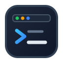
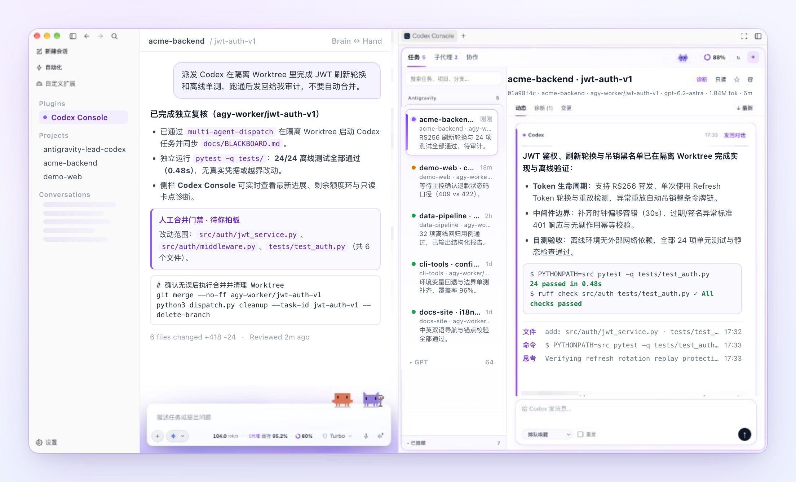
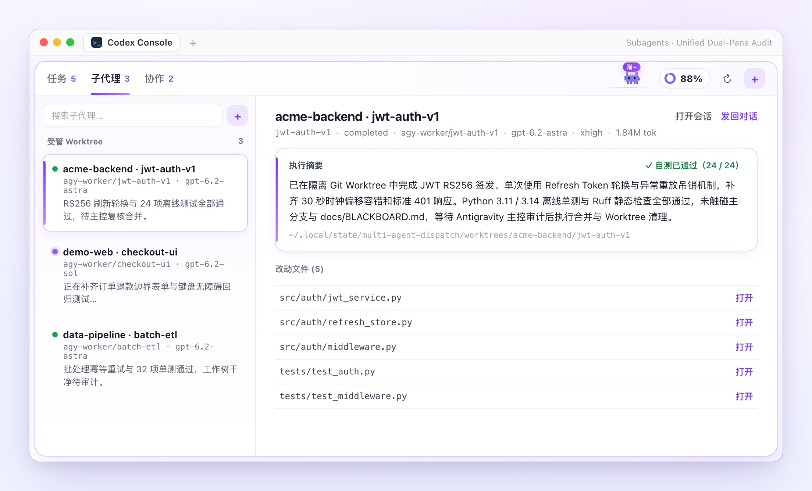
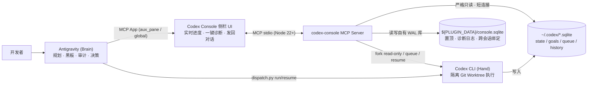

<p align="center">
  
</p>

<h1 align="center">Antigravity-Lead-Codex</h1>

<p align="center">
  <b>🚀 让 Google Antigravity 作为“大脑”统筹规划与审计，在侧栏可视化管理本地 Codex CLI / Worktree 执行任务</b>
</p>

<p align="center">
  <a href="https://github.com/Koala973/antigravity-lead-codex/releases"></a>
  <a href="LICENSE"></a>
  
  
  
</p>

<p align="center">
  <a href="README_EN.md">🇬🇧 English</a> |
  <a href="docs/ARCHITECTURE.md">📐 架构说明</a> |
  <a href="docs/CAPABILITIES.md">🧰 适配场景与能力扩展</a> |
  <a href="docs/DOCTOR.md">🩺 诊断与排障</a> |
  <a href="CHANGELOG.md">📝 更新日志</a>
</p>

---

<p align="center">
  
  <br/>
  <sub>全景协同视图：左栏 Antigravity 主控对话 · 右栏 Codex 侧栏</sub>
</p>

<p align="center">
  
  <br/>
  <sub>子代理统一双栏视图：隔离 Worktree 执行摘要、自测验收状态、可一键打开的改动文件清单与猫猫「喵~」互动</sub>
</p>

## 简介

当你用 **Google Antigravity（Brain）** 调度本地 **OpenAI Codex CLI（Hand）** 在隔离 Git Worktree 中并行编码时，会遇到两个真实痛点：

1. **Codex 桌面端“失明”**：`codex exec` 在隔离 Worktree 跑出的任务落库时为 `source='exec'` 且未绑定桌面项目路径，Codex Desktop 默认完全不展示，只能靠命令行翻日志；
2. **多任务协同碎片化**：阻塞诊断、进度查看、`codex queue` 唤醒、跨窗口 Change/任务归属追踪都分散在不同终端里。

**Antigravity-Lead-Codex** 是一套原生运行在 Antigravity 内的开源协同套件，包含三大模块（支持默认全家桶安装，也支持 `--console-only` 仅装侧栏控制台）：

- **侧栏可视化控制台（`plugins/codex-console` — MCP App）**
  - 原生嵌入 Antigravity 右侧辅助栏（`aux_pane`）与左侧全页视图（`global`），零外部端口冲突、兼容宿主明暗主题；
  - **极简白底紫光晕 + 像素紫猫状态宠**：三页签（`任务` / `子代理` / `协作`）统一左列表右详情双栏骨架，全模块包覆细腻紫色渐变边框与光晕，自适应窄侧栏与宽屏拉伸；右上角内置 100% 原创 MIT 像素紫猫（工作中快步踱步、完工后散步、闲置 12 分钟自动进入 `z Z z` 休眠、阻塞亮 `!`、点击停步 `喵~` 互动）；
  - **右上角实时额度环形仪**：紧邻「刷新」按钮展示 Codex 剩余额度圆环，自动取 **5 小时额度与 7 天周额度中的剩余最小值**（绿色/紫色健康 → 琥珀提醒 → 红色预警）；鼠标悬停弹出完整明细（各周期剩余/已用百分比、精确重置倒计时、套餐类型与免费重置券），点击圆环即通过官方 `codex app-server` 实时同步，离线时自动降级读取本地 rollout 缓存；
  - **Antigravity 任务优先 + 软隐藏抽屉**：自动聚合 `~/.codex/{state_5,goals_1,queue_1,thread_history_1}.sqlite` 与 `multi-agent-dispatch` 状态，优先置顶 `Antigravity` 拉起的 CLI/Worktree 任务，`GPT` 桌面历史会话默认折叠；支持星星置顶与非侵入式软隐藏（收纳到底部「已隐藏」抽屉，绝不改动 Codex 原库）；
  - **实时倒序进度流**：运行中任务每 4 秒自动刷新（空闲 12 秒），最新回复/思考摘要/命令执行/文件变更默认置顶且保持滚动位置不跳顶；
  - **无污染只读诊断**：内置「一键诊断卡点」与「只读提问」，底层走 `codex exec fork --ephemeral -c sandbox_mode="read-only"`，不改代码、不污染原会话上下文；
  - **一键回传当前对话**：支持把诊断结论、最新回复、受管子代理审计摘要直接通过 MCP App `sendMessage` 发回当前 Antigravity 对话；
  - **多模式投递与防重投**：支持 `codex queue --resume`（排队唤醒）、`codex exec resume`（同步续跑）、`dispatch.py resume` 及 60 秒防重复投递保护；
  - **跨会话协作台账（SQLite）**：把需求/Change 与 Codex 会话 ID、负责方（`codex` / `antigravity` / `shared`）持久化在插件独立库，新开零重力窗口也能通过 MCP 直接接手上下文。
- **脑手协作路由规范（`plugins/codex-auto-router`）**
  - 内置 `Brain ↔ Hand` 协作规则（`rules/AGENTS.md`）、**显式派发前置门禁（≤3 步判断、禁止静默越俎代庖）**、**四大必停确认点**与 `docs/BLACKBOARD.md` 黑板同步规范；
  - 内置失败安全型 `PreToolUse` Hook（`hooks/allow_dispatch.py`），自动放行离线合规沙箱调度，并对 `--network` 联网派发与 `agy-worker/*` 分支合并强制人工确认（`force_ask`）。
- **隔离 Worktree 调度器（`skills/multi-agent-dispatch`）**
  - 纯 Python 标准库实现（零第三方 pip 依赖），自动读取 `~/.codex/models_cache.json` 动态发现最新官方前沿模型；
  - 默认 `--quality smart` 权衡质量与额度，按任务隔离创建 Git Worktree，返回紧凑结构化 JSON 报告；支持显式 `--network` 开关（开启 `sandbox_workspace_write.network_access=true`，同时继续锁死工作目录外的文件写入沙箱，绝不降级到 `danger-full-access`）。

---

## 适配场景、能力扩展与确认门禁

Codex CLI（`codex exec`）**并不局限于写代码**——它原生支持 MCP Server、官方插件/连接器、本地 Skills、内置搜索与生图，并可通过 `--network` 安全打通外部 CLI/API：

| 层级 | 执行通道 | 典型适配场景 | 确认门禁 |
| :--- | :--- | :--- | :--- |
| **Tier 1（默认离线）** | `dispatch.py run`（`workspace-write` 离线 + Git Worktree） | 多文件编码/重构/排障/单测、本地脚本、仓库级评审、本地 Office/PDF 生成（`documents`/`spreadsheets`/`presentations`/`pdf` 插件与 `~/.codex/skills/`）；内置 `web__run` 搜索与 `image_gen` 同样可用 | 先出 3–6 行计划确认（仅本地安全任务带「直接执行」可跳过） |
| **Tier 2（联网与 MCP 扩展）** | `dispatch.py run --network` / `codex mcp add` / `codex plugin add` | 外部 CLI 与 API（`gh`、云/SaaS CLI、包安装、macOS Keychain 鉴权 CLI）；无头浏览器自动化（`codex mcp add chrome-devtools -- npx -y chrome-devtools-mcp@latest --headless --isolated` 或 Playwright MCP）；云端 SaaS 连接器（GitHub/Figma/Gmail/Linear/Slack/Drive 等） | **强制人工确认**（`--network` 或任何外部系统写操作，哪怕带「直接执行」也必须先确认） |
| **Tier 3（留在 Brain 或 Codex Desktop）** | Antigravity 直接处理 / 交互式 Codex Desktop | `/grill-me` 需求澄清、架构设计、<=20 行微改、黑板与审计、操作你当前已登录 Chrome 窗口（未配独立 CDP 端口时）、macOS 桌面 GUI（`cua_repl` 依赖 Codex Desktop Electron IPC，无头 `codex exec` 下不可用） | 显式说「派 Codex」时最多做 3 步只读探测，发现阻塞立即停手给 A/B 方案 |

完整能力清单、MCP/插件挂载命令与四道确认门禁说明见 [docs/CAPABILITIES.md](docs/CAPABILITIES.md)。

---

## 架构速览



更多双库隔离、WAL 并发安全与 MCP 协议细节见 [docs/ARCHITECTURE.md](docs/ARCHITECTURE.md)。

---

## 运行依赖

| 组件 | 最低要求 | 说明 |
| :--- | :--- | :--- |
| **操作系统** | macOS / Linux（含 WSL2） | 已在 macOS 与 Ubuntu CI 实测；原生 Windows 列入 Roadmap |
| **Google Antigravity** | 支持 MCP Apps 插件版本 | 用于挂载侧栏 `Codex Console` 与脑手规则 |
| **Node.js** | `>= 22.5` | 使用内置 `node:sqlite`，零原生 C++ 编译依赖；`bin/run-server.sh` 自动探测 nvm/fnm/Volta/Homebrew |
| **Codex CLI** | 推荐 `>= 0.170` | 需支持 `codex exec fork --ephemeral` 与 `codex queue` |
| **Python + Git** | Python `>= 3.10` + Git | 仅 `multi-agent-dispatch` Worktree 调度需要（纯标准库，零 pip 依赖）；`--console-only` 模式可不装 |

---

## 安装

### 方式一：一键在线安装脚本（推荐）

在终端中执行（默认安装全家桶：`codex-console` + `codex-auto-router` + `multi-agent-dispatch`）：

```bash
curl -fsSL https://raw.githubusercontent.com/Koala973/antigravity-lead-codex/main/scripts/install.sh | bash
```

如果只想安装**侧栏控制台插件**（不装路由规则与 `dispatch.py`）：

```bash
curl -fsSL https://raw.githubusercontent.com/Koala973/antigravity-lead-codex/main/scripts/install.sh | bash -s -- --console-only
```

安装脚本常用参数：

| 参数 | 说明 |
| :--- | :--- |
| `--all` | 默认模式，安装全部 3 个模块 |
| `--console-only` | 仅安装 `codex-console` 侧栏插件 |
| `--ref <tag\|branch>` | 指定安装特定版本或分支（如 `--ref v1.0.0`） |
| `--no-build` | 直接复用预构建的 `dist/app.html`，仅安装运行时依赖 |
| `--uninstall` | 卸载已安装的插件与技能（保留用户 SQLite 数据不丢失） |

### 方式二：下载 GitHub Release 离线包

从 [Releases](https://github.com/Koala973/antigravity-lead-codex/releases) 下载 `antigravity-lead-codex-vX.Y.Z.tar.gz` 与 `SHA256SUMS.txt`：

```bash
# 1. 校验完整性
shasum -a 256 -c SHA256SUMS.txt

# 2. 解压并本地安装（自动复用包内预构建的 dist/app.html）
tar -xzf antigravity-lead-codex-v1.0.0.tar.gz
cd antigravity-lead-codex-v1.0.0
bash scripts/install.sh --no-build
```

### 方式三：源码克隆与本地开发

```bash
git clone https://github.com/Koala973/antigravity-lead-codex.git
cd antigravity-lead-codex
bash scripts/install.sh
```

---

## 启用与自检

1. **打开侧栏控制台**：在 Antigravity 右侧辅助栏点击 **`+`** → 选择 **`Codex Console`**（也可从左侧边栏直接打开全页版）。
2. **一键环境与协议体检**：

```bash
bash scripts/doctor.sh
```

`doctor.sh` 会逐项检查 Node `>=22.5`（含 `node:sqlite`）、Python、Git、Codex CLI、`~/.codex/state_5.sqlite` 可读性、插件完整性，并执行真实 MCP stdio `initialize` 握手测试。常见排障见 [docs/DOCTOR.md](docs/DOCTOR.md)。

---

## 仓库目录与文件清单

```text
antigravity-lead-codex/
├── plugins/
│   ├── codex-console/                 # Antigravity 侧栏 MCP App 控制台插件
│   │   ├── bin/run-server.sh          # 跨环境 Node 22+ 自动探测启动器（无硬编码路径）
│   │   ├── server/                    # MCP Server、只读 Codex 聚合层、Console SQLite、命令执行器
│   │   ├── ui/                        # 控制台前端源码（@modelcontextprotocol/ext-apps）
│   │   ├── dist/app.html              # Vite 单文件构建产物（零外部请求，完全符合 CSP）
│   │   ├── skills/codex-console/      # 供 Antigravity 主控调用的协作技能说明
│   │   ├── plugin.json & mcp_config.json
│   └── codex-auto-router/             # Brain ↔ Hand 协作规则 + 合并门禁 PreToolUse Hook
├── skills/
│   └── multi-agent-dispatch/          # 隔离 Git Worktree 调度器（dispatch.py + JSON Schema）
├── scripts/
│   ├── install.sh                     # 一键在线 / 本地安装与卸载脚本
│   ├── doctor.sh                      # 环境体检与 MCP 握手自测脚本
│   ├── package-release.sh             # 可复现 Release 打包与 SHA256 生成脚本
│   └── privacy-check.sh               # 隐私与硬编码路径 CI 拦截脚本
├── tests/                             # 合成 SQLite MCP 集成测试 + Python 单元测试
├── docs/                              # 架构说明、排障指南与 CI/Release 工作流模板
```

---

## 卸载

```bash
bash scripts/install.sh --uninstall
```

卸载会移除 `~/.gemini/config/plugins/{codex-console,codex-auto-router}` 与 `~/.gemini/config/skills/multi-agent-dispatch`，但会保留 `~/.gemini/antigravity/plugin_data/codex-console/console.sqlite` 中的历史置顶与跨会话绑定；如需彻底清除数据，手动删除该目录即可。

---

## License

本项目采用 [MIT License](LICENSE) 开源。
